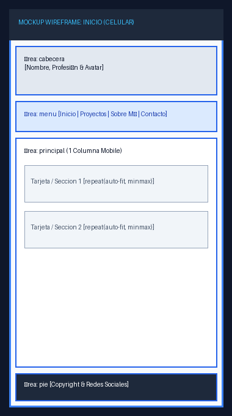
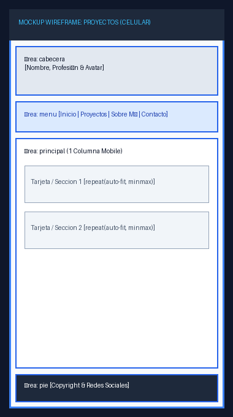
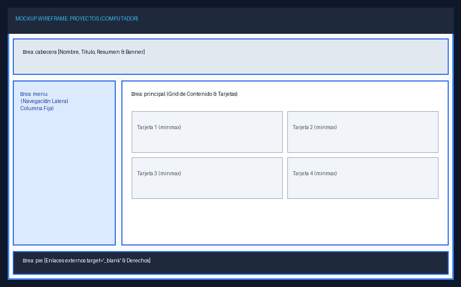
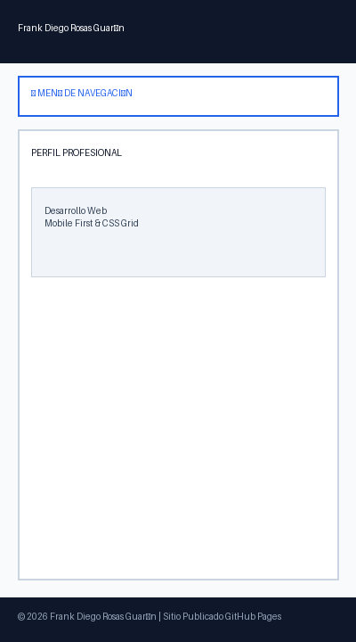
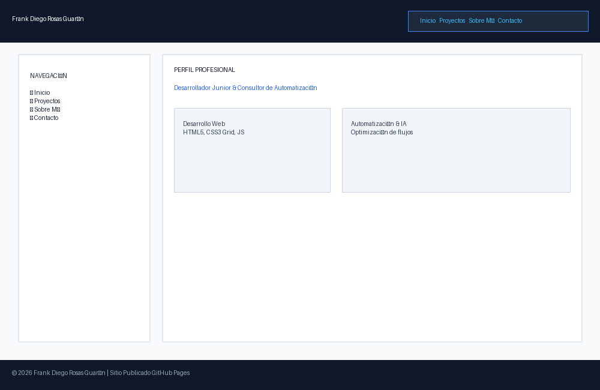

# Hoja de Vida Web - Frank Diego Rosas Guarín

Sitio web personal, responsive e interactivo con hoja de vida profesional y páginas de portafolio interconectadas, desarrollado con HTML5 semántico y CSS3 Grid Layout.

**Sitio publicado en GitHub Pages:** https://diegorosasguarin.github.io/Hoja_de_Vida_Diego_Rosas/index.html

---

## 📑 Páginas del Sitio
- `index.html`: Hoja de vida principal con Perfil Profesional, Formación Académica, Habilidades Principales y Experiencia Laboral.
- `proyectos.html`: Portafolio interactivo con proyectos destacados en desarrollo web, automatización con IA, domótica e imágenes.
- `sobre-mi.html`: Página sobre mi filosofía de trabajo multipotencial, enfoque autodidacta y objetivos profesionales.
- `contacto.html`: Formulario de contacto directo e información profesional de contacto.

---

## 🎨 Mockups de Diseño Wireframe (Fase 1)

### Hoja de Vida (Inicio)

### Proyectos

### Sobre Mí

### Contacto

---

## 📸 Capturas del Sitio Publicado (Fase 4)

---

## 📐 Explicación de Breakpoints (Responsive)
- **Base CSS (Mobile First):** Diseñado inicialmente para pantallas de celular (`< 600px`). Utiliza una sola columna en `grid-template-areas` (`cabecera`, `menu`, `principal`, `pie` apilados verticalmente).
- **Breakpoint 1 (600px - Tablet):** El menú de navegación se reorganiza horizontalmente (`flex-direction: row`) y la tarjeta de perfil muestra la imagen alineada junto al texto.
- **Breakpoint 2 (1024px - Computador):** La estructura del contenedor adopta una grilla de 2 columnas (`240px 1fr`) con `grid-template-areas: "cabecera cabecera" "menu principal" "pie pie"`, fijando el menú de navegación en el lateral izquierdo.

---

## 🚀 Proceso de Publicación en GitHub Pages
1. **Creación del repositorio:** Creé un repositorio público en GitHub denominado `hoja-de-vida`.
2. **Carga de archivos:** Subí todos los archivos (`index.html`, `proyectos.html`, `sobre-mi.html`, `contacto.html`, `styles.css`, carpetas `img/`, `mockups/`, `capturas/` y `README.md`) asegurando nombres en minúsculas y sin espacios.
3. **Activación de GitHub Pages:** Ingresé a **Settings > Pages** en el repositorio de GitHub.
4. **Configuración de rama:** En la sección **Source**, elegí la rama `main` y el directorio raíz `/ (root)` y guardé los cambios.
5. **Verificación:** Esperé la compilación de GitHub Actions y abrí la URL pública desde una pestaña de incógnito y desde mi teléfono celular.

---

## 📚 Fuentes Consultadas
- [Documentación Oficial de GitHub Pages](https://docs.github.com/es/pages)
- [MDN Web Docs - CSS Grid Layout](https://developer.mozilla.org/es/docs/Web/CSS/CSS_Grid_Layout)
- [MDN Web Docs - Responsive Design](https://developer.mozilla.org/es/docs/Learn/CSS/CSS_layout/Responsive_Design)
- [W3C Markup Validation Service](https://validator.w3.org/)
